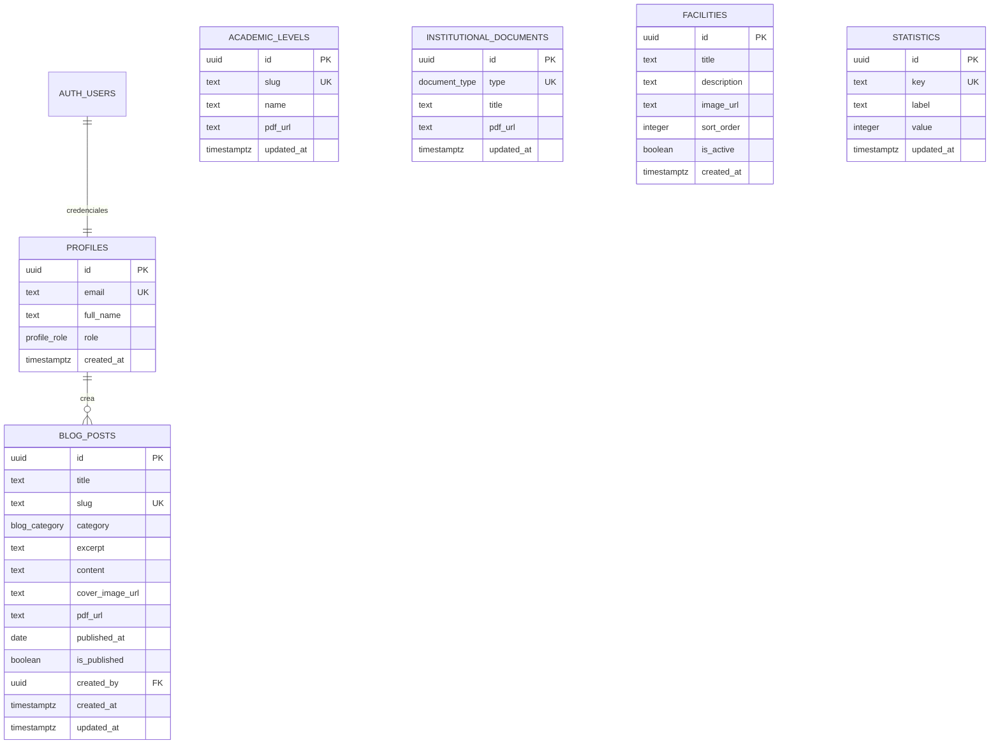

# Modelo entidad-relación

El modelo está implementado en PostgreSQL (Supabase) y versionado en `supabase/migrations/0001_init.sql`.



## Descripción de entidades

### `profiles`
Extiende `auth.users`. Guarda el correo, el nombre y el rol (`admin` o `editor`). Las contraseñas las gestiona Supabase Auth; nunca se almacenan en esta tabla.

Un trigger crea el perfil al registrar un usuario. El primer usuario queda como `admin`; los siguientes como `editor`. Para este proyecto solo se crea la cuenta de la rectora.

### `blog_posts`
Publicaciones del blog. `category` distingue:

- `evento`: contenido con imagen de portada.
- `circular`: comunicado con PDF descargable.

`slug` es único y se genera a partir del título. `is_published` permite guardar borradores.

### `academic_levels`
Referencia al PDF del temario de cada nivel. Las descripciones y horarios son contenido estático en `src/features/academic-levels/academic-levels.types.ts`, tal como define el informe de arquitectura. Los 8 niveles son:

`prejardin`, `jardin`, `transicion`, `primero`, `segundo`, `tercero`, `cuarto`, `quinto`.

### `institutional_documents`
Dos registros únicos:

- `manual_convivencia`
- `resolucion_estudios`

Solo almacena el título y la URL del PDF.

### `facilities`
Galería de instalaciones. `sort_order` define el orden y `is_active` permite ocultar una foto sin eliminarla.

### `statistics`
Contadores de la página de inicio. Claves únicas:

- `docentes`
- `estudiantes`
- `graduados`
- `anios_experiencia`

El valor se muestra con el sufijo `+` en la interfaz.

## Storage

| Bucket | Público | Contenido |
|---|---|---|
| `images` | Sí (lectura) | Portadas del blog y fotos de instalaciones |
| `documents` | Sí (lectura) | Temarios, manual de convivencia, resolución y circulares |

La escritura y el borrado están restringidos al rol `admin` mediante políticas sobre `storage.objects`.

## Convenciones

- Nombres de tablas y columnas en `snake_case`.
- Identificadores `uuid` con `gen_random_uuid()`.
- `created_at` y `updated_at` en `timestamptz`.
- Enums de PostgreSQL para categorías y tipos.
- Integridad referencial con `on delete set null` en `blog_posts.created_by`.
- Índices para las consultas públicas: publicaciones, categorías e instalaciones.

## Migraciones

```bash
# Opción A: SQL Editor de Supabase
# Ejecutar 0001_init.sql y luego seed.sql

# Opción B: Supabase CLI
supabase link --project-ref TU_PROJECT_REF
supabase db push
```

Para regenerar los tipos después de un cambio de esquema:

```bash
supabase gen types typescript --linked > src/types/database.ts
```
